# Social Gallery V3 — مراجعة الواجهات والحركة

التاريخ: 2026-10-28. الأساس: `main` عند `4bdbd58`؛ العمل في `feature/v3-ui-motion-reference-match`. لا دمج ولا تغيير للموقع المنشور قبل موافقة المستخدم.

## 1. المصادر والمشاهدة

فُحصت الملفات الأربعة بصريًا عبر إطارات تغطي كامل المدة بمعدل إطارين/ثانية، ثم نوافذ التفاعل بمعدل 15 إطارًا/ثانية، واستُخرجت مقاطع قصيرة لهذه النوافذ. الأبعاد كلها **598×1280**. المعدلات متغيرة؛ لا يعني `r_frame_rate=90000/1` أن التسجيل 90000 إطار/ثانية.

| الملف الأصلي | المحتوى المشاهد | مدة الملف بالثواني | متوسط الإطارات/ثانية | التفاعلات المرئية |
| --- | --- | ---: | ---: | --- |
| `SVID_20261028_163355_1.mp4` | TikTok عربي، داكن، فيديو كرة قدم | 23.300 | 37.925 | لايك/إلغاؤه، حفظ أصفر/إلغاؤه، فتح وإغلاق التعليقات، شريط إجراءات على اليسار، فيديو بتنسيقات طولية وعريضة |
| `SVID_20261028_163428_1.mp4` | Instagram عربي، داكن، Feed وStories | 24.706 | 51.361 | لايك وإلغاؤه، ضغط مزدوج وقلب ملوّن، حفظ وإلغاء، فتح التعليقات ولوحة المفاتيح، إغلاقها |
| `SVID_20261028_163506_1.mp4` | X عربي، داكن، Feed مع فيديوهات داخل منشورات | 34.903 | 53.953 | تمرير، منشور مع فيديو، محرر رد، انتقالات والعودة للـFeed؛ حجم أيقونات شريط التفاعل صغير ولا يتيح اشتقاق easing دقيق |
| `SVID_20261028_164441_1.mp4` | Social Gallery V2 داخل متصفح، قسم X | 8.793 | 11.971 | فتح القائمة قرابة 2s، إغلاق قرابة 3.3s، فتح ثانٍ قرابة 4.5s، ثم محاولات إغلاق؛ إطار القائمة الأخير يبقى ظاهرًا |

متوسط الإطارات من `avg_frame_rate` مع ffprobe. اختير معدل 15fps للفحص القريب؛ الحدود الزمنية أدناه تقريبية بخطوة 66.7ms، وتتأثر بإطارات المصدر المتكررة. أثر اللمس الأبيض في التسجيل هو مؤشر النظام وليس مؤثرًا سننسخه.

## 2. تحليل التفاعل والقرارات

| التفاعل | الإطار قبل/أثناء/بعد في المصدر | ما تدعمه المشاهدة | تنفيذ V3 |
| --- | --- | --- | --- |
| TikTok Like | 2.867 / 3.067 / 3.333s | قلب أبيض ممتلئ يتحول إلى أحمر، يكبر ثم يستقر خلال نحو 0.3s؛ الإلغاء يعيده للأبيض؛ لا دليل على اهتزاز | لون فوري، 300ms، scale .8 → 1.18 → .96 → 1؛ إلغاء 160ms |
| TikTok Save | 8.000 / 8.467 / 8.867s | أبيض → أصفر، ارتداد وحلقة صفراء قصيرة؛ تبقى الأيقونة صفراء؛ الإلغاء أبيض | ملء ولون أصفر، ارتداد 300ms، حلقة 440ms تختفي بالشفافية؛ لا جسيمات |
| Instagram Double tap | 8.333 / 8.533 / 9.067s | قلب ملوّن يكبر قرب موضع اللمس، يبقى وجيزًا ثم يختفي؛ نافذة أول قلب نحو 0.67s | قلب قرب موضع النقر، 800ms، opacity 0→1→0، scale .25→1.1→1، ميل بسيط ولون ذهبي→وردي. الفرق الزمني نحو 0.13s معلن |
| Instagram Like / Save | 3–7s و11–16s | تفعيل ملء/لون، عكس الحالة عند الإلغاء؛ تفاصيل حركة الحفظ صغيرة في الصور العامة | لايك أحمر وحفظ بلون الواجهة، 300ms للتفعيل و160ms للإلغاء؛ القيم هندسية تقريبية وليست قياسات رسمية |
| X Like / Save | 26–31s | أيقونات دقيقة منخفضة الدقة في التسجيل؛ لا يمكن استخراج spring أو scale موثوقين | حركة أهدأ: 220ms و140ms، وردي للايك وأزرق للحفظ؛ اختيار تصميمي معلن |
| إغلاق قائمة الموقع | 3.267 / 3.333 / 3.400s | القائمة تبقى كاملة ثم تختفي؛ التسجيل 12fps لا يكفي لإثبات سبب تعطل جهاز المستخدم | إبقاء الطبقة أثناء خروج transform لمدة 180ms، دخول 240ms، opacity للخلفية فقط؛ لا إعادة تخطيط عبر height |

الإطارات المرجعية المتتابعة:

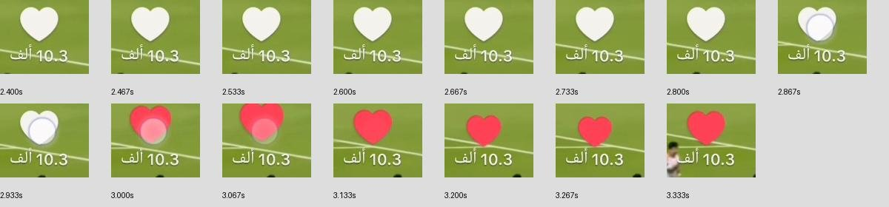
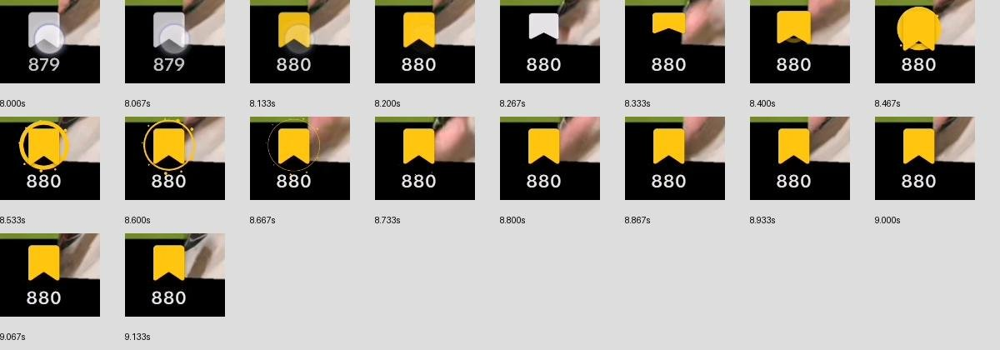
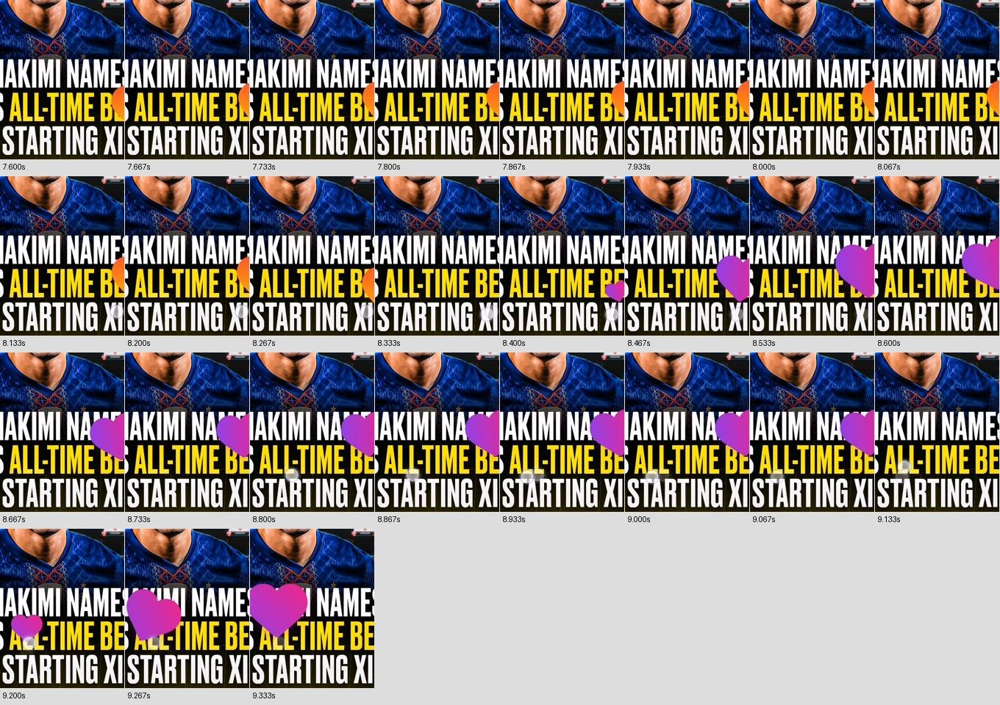
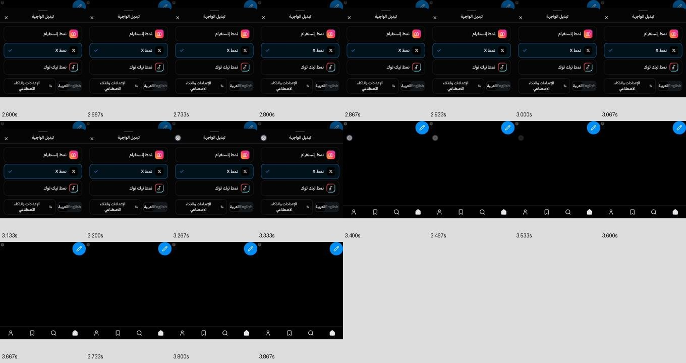

لا يمكن استنتاج معامل spring الأصلي أو easing دقيق من التسجيلات. منحنيات CSS السابقة تقريب بصري، دون ادعاء تطابق 100% أو زمن استجابة أصلي بالمللي ثانية.

## 3. مراجعة النسخة السابقة والفروق الفعلية

الموقع المنشور يعرض بوابة دخول ChatGPT لهذا المتصفح. لم تُغيّر جمهوره أو نسخته. التقطت صور الأساس من تشغيل `main` نفسه محليًا قبل التعديل، وليست صورًا من خلف بوابة الدخول.

1. **الصور — تعمل مع اختلافات مرئية:** كان الشعار بمحاذاة الطرف وأزرار الرأس تتضمن مشاركة شكلية؛ أصبحت هوية الرأس وسطية مع إضافة محلية فعلية. شريط الإجراءات يضع العدّادات قرب الأيقونات. صُحح أيضًا توريث الوضع الداكن إلى القسم الداخلي بدل إعادة فرض ألوان فاتحة عليه. بقيت Stories والألبومات والبحث والملف والمحفوظات ووظائفها. القلب السابق أبيض ثابت الموضع؛ الجديد ملوّن عند موضع النقر. الصور تظل صورًا فقط.
2. **الفيديوهات — تعمل؛ المصدر الخارجي متعذر هنا:** كانت الفيديوهات تُقص بـcover؛ أصبحت contain كما تظهر الحواف السوداء في المرجع. حسّنت مناطق لمس الإجراءات إلى 44px، وأضاف الحفظ اللون والحلقة المرجعيين، والمشاركة سهمًا أقرب للمرجع. الفيديو المحلي يعمل؛ فشل بعض روابط العينة الخارجية كان موجودًا قبل التعديل.
3. **الملاحظات — تعمل مع نقص المرفقات سابقًا:** النصوص القديمة محفوظة. نُقلت أدوات تحرير/حذف/اقتباس إلى قائمة خيارات، وأصبحت الصورة الشخصية أعلى البطاقة، مع شريط تفاعل أهدأ ومرفق واحد. جرى تثبيت اتجاه المعرف اللاتيني داخل العربية. لا معرض مستقل داخل X.
4. **قائمة التبديل — خروج فوري مؤكد في الكود السابق:** `if (!open) return null` أزال الطبقة قبل إمكان رسم خروج. لم توجد معالجة History للرجوع، واستعادة التركيز كانت تسمح بالتمرير التلقائي. الإصلاح يحتفظ بالطبقة للخروج، ويستعيد التركيز مع preventScroll، ويضع الأوراق خارج البطاقات في جذر الهاتف. قفل التمرير محصور بوجود الطبقة ويزول معها، دون تعديل body. تعالج قائمة المنصات popstate وتمنع تكرار history.back عند الضغط السريع.

هذا إصلاح لأسباب دورة الحياة والتداخل المؤكدة؛ لا نزعم قياس انعدام التقطيع على هاتف المستخدم أو تشخيص كل سبب متعلق بمتصفحه.

تسميات القائمة: **صور / فيديوهات / ملاحظات**، خط عربي مرخص واحد بحجم 17px وline-height 28px، أوزان متقاربة لهويات المنصات، ومحاذاة واحدة مع الأيقونات. لم تُستبدل بالتسميات القديمة.

## 4. المقارنات المرئية

يسار الصورة المرجع في توقيته، يمينها حالة التنفيذ المستقرة في viewport فعلي 360×800 داخل iframe. المحتوى التجريبي مختلف عن المحتوى الاجتماعي الأصلي؛ هذه مقارنة مكونات وتخطيط، وليست pixel diff لمحتوى متطابق.

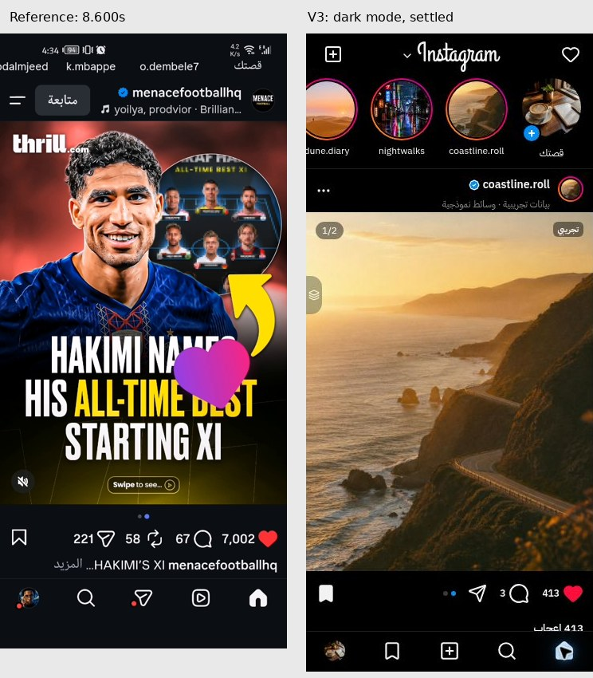
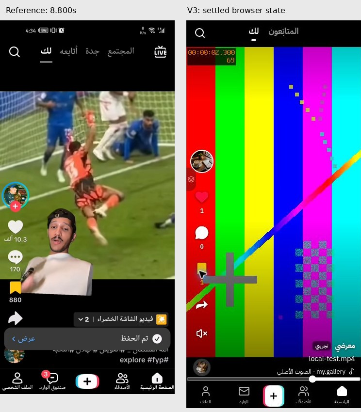
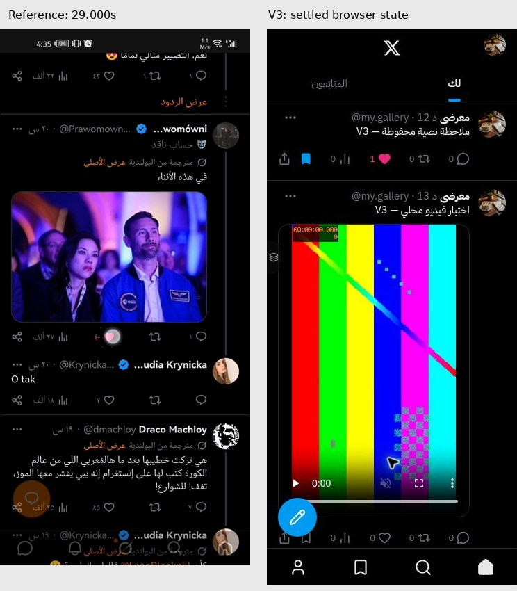
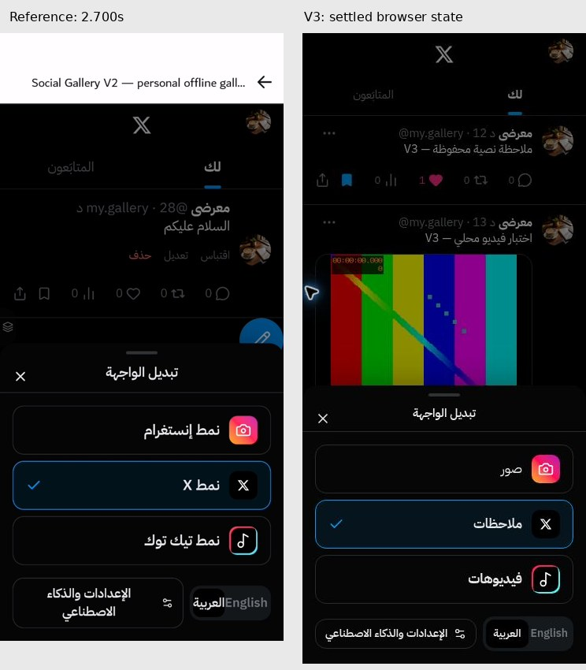

صور قبل/بعد: الأساس 430px على سطح المكتب مصغر للعرض، والتنفيذ 360px. اختلاف أبعاد الأساس معلن؛ لا تستخدمها لإثبات تطابق بكسلي.

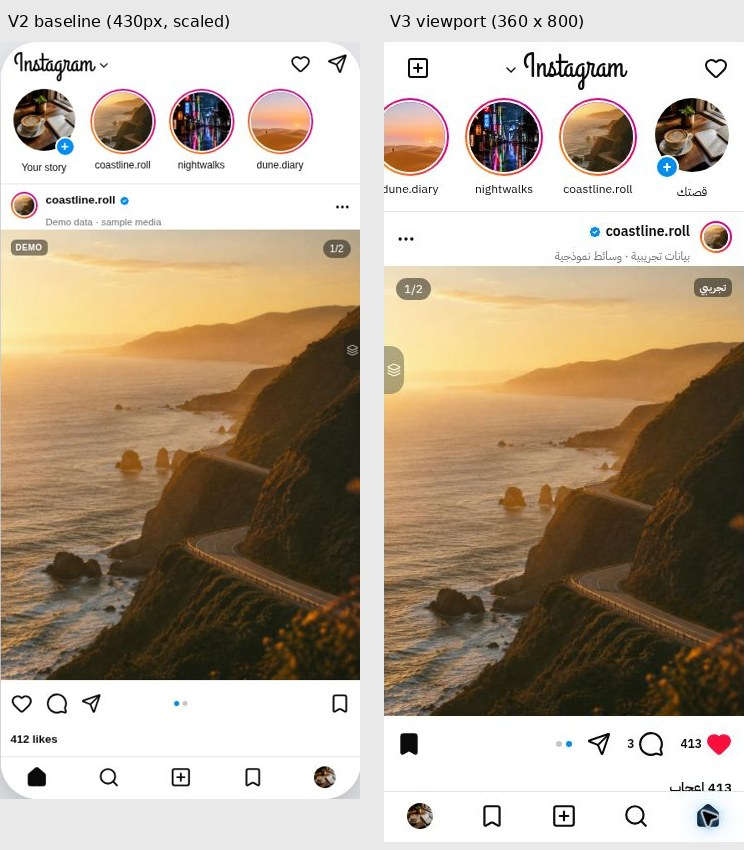
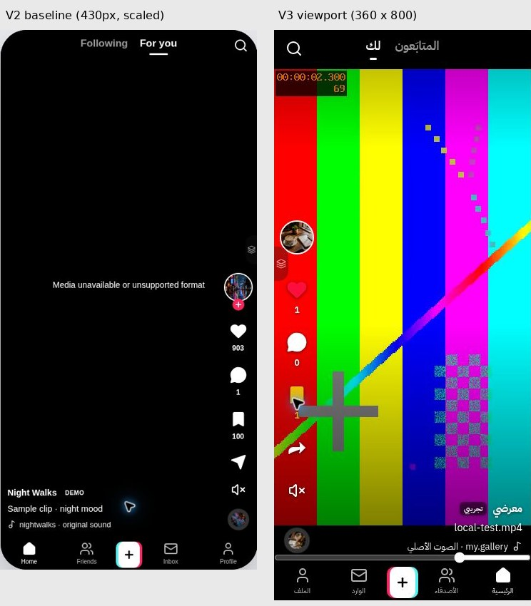
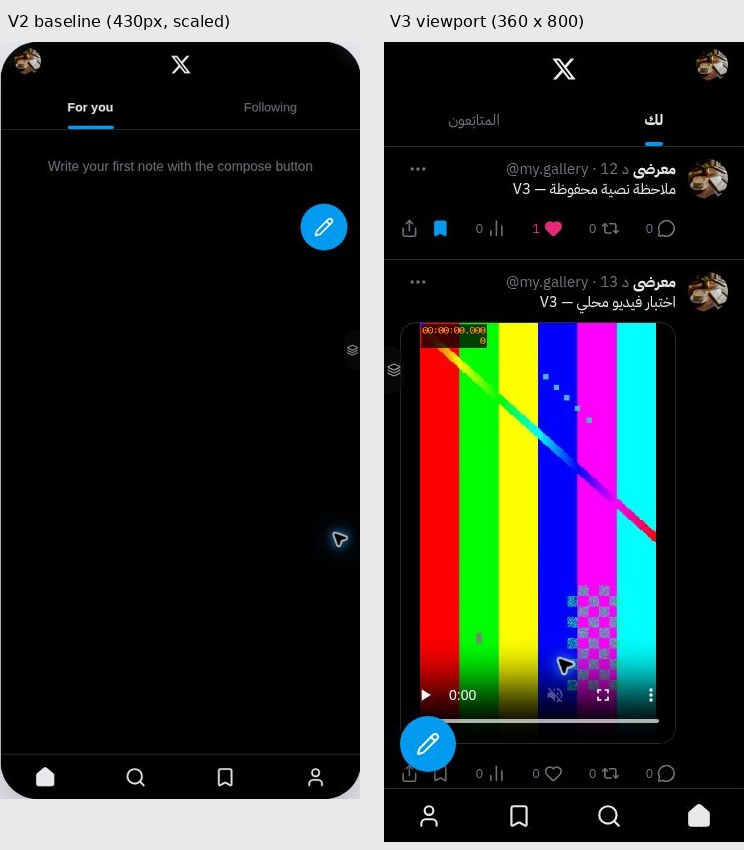
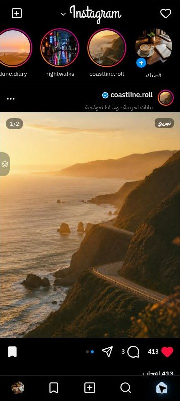
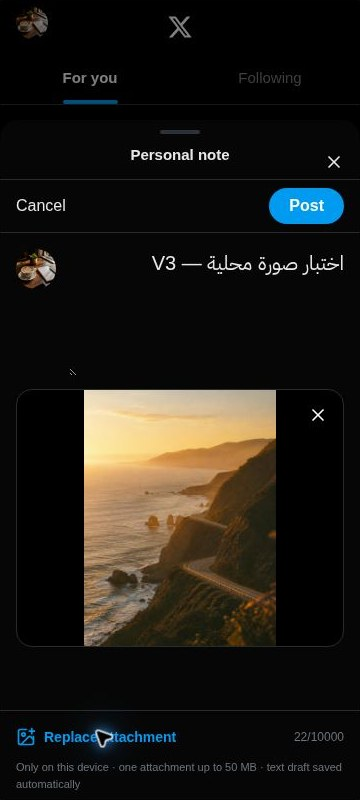

## 5. تخزين المرفقات وحماية البيانات

- احتُفظ بالمفتاح `social-gallery-v1` وبقاعدة `social-gallery-media`؛ ترقية إضافية من الإصدار 1 إلى 2 تضيف store اسمه `noteMedia` دون حذف `media` أو سجلاته.
- بيانات الملاحظة تخزن معرّف المرفق ونوعه واسمه فقط، والملف Blob في IndexedDB. يعاد إنشاء object URL عند القراءة ويُلغى عند مغادرة المكوّن؛ لا تحفظ الملاحظات blob URL مؤقتًا.
- منتقي واحد ومعاينة وحذف/استبدال قبل النشر. الملف المختار لا يكتب قبل النشر، وإغلاق المحرر لا يخلّف ملفًا محفوظًا. مسودة النص فقط تُحفظ تلقائيًا؛ ملف مسودة غير منشورة لا يبقى بعد reload وهذا واضح في وصف المحرر.
- الأنواع: JPEG/PNG/WebP/GIF/AVIF وMP4/WebM/Ogg، حد 50MiB، رفض الفارغ/غير المدعوم. دعم codec النهائي يتبع المتصفح، مع رسالة تعذر العرض عند الخطأ.
- يُكتب Blob أولًا ثم تثبت metadata في localStorage. عند فشل الحفظ تبقى الملاحظة والمرفق في المحرر، ويزال الملف الجديد غير المرتبط. عند الحذف/الاستبدال لا يحذف الملف القديم إلا بعد نجاح metadata وعدم بقاء مرجع إليه.
- فشل تنظيف Blob لا يحذف أي بيانات إضافية؛ قد يبقى ملف غير مستخدم بدلاً من المخاطرة بملف حي. فُحصت أخطاء السعة آليًا، ولم نملأ مساحة متصفح المستخدم.
- الفيديو داخل الملاحظة له controls وplaysInline، muted افتراضيًا، بلا autoplay. الصورة تحتفظ بنسبة أبعادها.
- لا رفع سحابي، ولا Lovable، ولا مكتبة أنيميشن جديدة، ولا مسح لمخازن المستخدم.

## 6. التحقق الفعلي

| الخطوة | النتيجة والحالة |
| --- | --- |
| 1. `npm run typecheck` | ناجح |
| 2. `npm run lint` | صفر أخطاء؛ 7 تحذيرات Fast Refresh موجودة سابقًا |
| 3. `npm run test` | 22 اختبارًا ناجحًا في 4 ملفات، منها ترقية قاعدة v1 فعلية، بقاء المرفقات بعد remount، عدم تسربها إلى المعارض، الاستبدال والإزالة، فشل السعة، الأنواع/الحجم، والتبديل السريع |
| 4. `npm run build` | ناجح؛ static SPA في dist |
| 5. عرضا 360×800 و393×873 | فُتح التطبيق داخل iframe لكل مقاس في Chrome السحابي؛ راجعت النص العربي والاتجاهات والمرفقات وشريط التنقل. ليس جهاز Android حقيقيًا |
| 6. نص / صورة / فيديو ثم reload | الثلاثة موجودة بعد إعادة التحميل؛ الفيديو المحلي readyState=4، أبعاده 360×640، controls=true، muted=true، autoplay=false |
| 7. تشغيل الفيديو | Space عبر لوحة المفاتيح أعطى paused=false؛ استيراده إلى TikTok أعطى paused=false وcurrentTime متقدمًا وobject-fit=contain |
| 8. Like / Save ثم reload | `aria-pressed=true` لكليهما في الملاحظة بعد التحميل؛ تم تفعيلهما كذلك في الصور والفيديوهات |
| 9. قائمة X خمس مرات متتالية | فُحصت مرتين أثناء العمل، آخرهما بعد إصلاح الخروج النهائي؛ كل مرة عادت دون طبقة باقية. overflow للـmain عاد auto والمحتوى قابل للتمرير |
| 10. الرجوع والضغط خارجها وEscape | Browser Back أغلق القائمة مع بقاء الصفحة؛ الاختبارات تغطي backdrop وEscape واستعادة التركيز. اختبر التبديل من الأقسام الثلاثة والعودة من X |
| 11. الصور والتعليقات والملف | ضغط مزدوج فعّل like، حفظ الصورة، فتح وإغلاق التعليقات، فتح الملف والعودة للصور |
| 12. الإنتاج وPR | لا نشر فوق النسخة الحالية ولا دمج؛ التسليم للمراجعة على الفرع |

التقطت المتصفح حالات قبل وبعد فعلية؛ لم تتوفر في API أداة تسجيل شاشة أو أخذ عينات 60fps. لذلك التسليم **تقرير بإطارات متقابلة وتوقيتات المصدر وقيم التنفيذ المعلنة**، وليس فيديو حركة مزعومًا أو قياس input latency/FPS. ظهرت مشكلة HMR أثناء تعديل context وحُلّت بإعادة تحميل المعاينة؛ الاختبارات وبناء الإنتاج يعملان. لا ندعي اختبار TalkBack أو لوحة مفاتيح Android الفعلية أو أداء GPU/بطارية هاتف حقيقي.

`prefers-reduced-motion` يلغي الحركات تقريبًا وحلقة TikTok، ويوجد focus مرئي وحصر Tab داخل الأوراق. لم تصدر شهادة امتثال وصول كاملة من الصور وحدها.

## 7. مصادر رسمية مكمّلة وحقوق الأصول

اطُّلع عليها في 2026-10-28. لا توجد واجهة واحدة موحّدة لكل نسخ 2026؛ التسجيلات هي المرجع الأول. لا ننقل تبويبات Reels أو المراسلة الحقيقية إلى معرض الصور المحلي.

- Meta: https://about.fb.com/news/2025/09/in-india-instagram-debuts-a-reels-first-experience-for-its-mobile-app/ — إعلان تجارب التنقل، لا مواصفة حركة رقمية.
- TikTok: https://support.tiktok.com/en/using-tiktok/exploring-videos/liking — زر القلب والضغط المزدوج والإلغاء.
- X: https://help.x.com/en/using-x/liking-posts-and-moments — تفعيل القلب وإلغاؤه.
- X: https://help.x.com/en/using-x/bookmarks — حالات الحفظ وخصوصيتها.
- Lucide الموجود بالمشروع: أيقونات مرخصة ISC؛ Grand Hotel وIBM Plex Sans Arabic الموجودان أصلًا من Google Fonts بدائل مفتوحة، وليسا خطوط Instagram/TikTok/X المملوكة. لا ملفات خطوط أصلية مسحوبة من التطبيقات.

## 8. الملفات المتغيرة

| الملف | التغيير |
| --- | --- |
| `src/gallery/instagram.tsx` | الرأس، عدادات الإجراءات، القلب عند اللمس، منع احتساب السحب ضغطًا مزدوجًا، حالات aria-pressed |
| `src/gallery/shared.tsx` | دورة خروج BottomSheet، portal، التركيز، منع تضارب سحب/نقر الفيديو، contain، مناطق لمس وردود التفاعل |
| `src/gallery/switcher.tsx` | التسميات والهوية، History/Back، منع رجوع مكرر عند الضغط السريع |
| `src/gallery/x.tsx` | محرر المرفقات، قائمة الخيارات، عرض المرفق، محاذاة واتجاه المعرف، حالات اللايك والحفظ |
| `src/gallery/note-attachment.tsx` | قراءة Blob وإدارة URL، صورة بنسبة صحيحة وفيديو controls، معالجة خطأ العرض |
| `src/gallery/note-media.ts` | التحقق والحدود وعمليات IndexedDB الخاصة بالمرفقات ورسائل فشل التخزين |
| `src/gallery/local-media.ts` | ترقية إضافية آمنة، بقاء وسائط المعرض، معالجة الاتصال المحجوب |
| `src/gallery/store.tsx` | تثبيت بيانات الملاحظة قبل الإغلاق والتنظيف الآمن للمرفقات |
| `src/gallery/types.ts` | وصف مرفق اختياري متوافق مع الملاحظات القديمة |
| `src/styles.css` | هندسة الأوراق، توريث وضع Instagram الداكن، التسميات، أنيميشنات المنصات وحالات reduced-motion ومحاذاة البطاقات |
| `src/gallery/i18n.ts` | تحديث اسم النسخة في الإعدادات إلى V3 |
| `src/routes/index.tsx` | عنوان V3 فقط؛ مزود البيانات وتقسيم الأقسام محفوظان |
| `src/test/gallery.test.tsx` | تحديث مسار تحرير/حذف الملاحظة عبر قائمة الخيارات وانتظار الخروج |
| `src/test/v3.test.tsx` | اختبارات المرفقات والهجرة والفشل والتبديل والتفاعلات |
| `docs/V3_UI_MOTION_AUDIT.md` و`docs/v3/*` | هذا التقرير وأدلة المشاهدة والمقارنات |

المعاينة المحلية مفتوحة في المتصفح السحابي. لا تتوفر أداة Preview منفصلة لإصدار من نفس الموقع؛ لم ننشئ مشروعًا جديدًا ولم نغير الرابط المنشور. القبول النهائي يتطلب مشاهدة المستخدم للمقارنات وموافقته على الواجهة والحركة والمرفقات قبل الدمج.
