# Social Gallery V3 — تصحيح الدقة البصرية وإعداد اللون

2026-10-28 · الفرع `feature/v3-ui-motion-reference-match` · مراجعة PR #3. هذه متابعة لإصلاحات V3 وليست إعادة كتابة. **لا دمج في main ولا نشر إنتاجي.**

## المراجع وطريقة المقارنة

المصادر الأساسية هي الصور الثلاث المرفقة. بقيت الفيديوهات الأربعة الأصلية متاحة وأعيد فحص شرائط إطاراتها، بما فيها نوافذ الحركة ذات عينات 15fps. لا نستنتج مواصفات كل إصدارات التطبيقات من لقطة واحدة.

| المرجع | الأبعاد الأصلية | قص منطقة النظام | مقاس التطبيق المستهدف CSS | الصورة داخل المقارنة |
| --- | --- | --- | --- | --- |
| TikTok `174956_com.zhiliaoapp.musically` | 718×1536 | أعلى 68px | 359×734 | 287×587 |
| Instagram `175217` | 513×1536 | أعلى 56px | 360×1039 | 288×831 |
| X `181752_com.android.chrome` | 718×1536 | أعلى 68px | 359×734 | 287×587 |

- اختيرت كثافة مقارنة 2 لصورتي TikTok/X، ومعامل 513/360 لـInstagram. هذه **معايرة عرض** وليست قراءة DPR الفعلية للهاتف. حد قص شريط الحالة تقديري بهامش نحو ±4 بكسلات أصلية.
- التقطت النسخة السابقة من الفرع نفسه قبل التحرير، والنسخة الجديدة من Chrome السحابي داخل iframe بالمقاسات أعلاه، مع تصغير CSS موحد 0.8 للوحتي قبل/بعد كي تظهر الشاشة الطويلة كاملة. المرجع خضع لتصغير مكافئ. لا يوجد خلط بين عرض 360 و430 في المقارنة الجديدة.
- شريط الساعة/الشبكة/البطارية تابع Android ولم يُبنَ داخل التطبيق. `safe-area-inset-*` باقٍ، وقيمته صفر في هذه المعاينة. شريط المتصفح على هاتف المستخدم خارج التطبيق.
- بيانات التغذية والصور والأرقام مختلفة عن المرجع، ولم ننسخ محتوى الحسابات أو الإعلانات. المقارنة هندسة UI، وليست pixel-diff لمحتوى متطابق.
- قبل TikTok يعرض عينة خارجية غير متاحة، وبعده فيديو اختبار محلي عمودي. هذا اختلاف **مصدر محتوى**؛ لا ندعي إصلاح خادم العينة الخارجية. توجد لقطة مستقلة لاختبار الفيديو الأفقي.
- المؤشر الأبيض/الأزرق الظاهر في بعض اللقطات مؤشر متصفح الاختبار، وليس مؤثرًا من التطبيق. مؤشرات لمس Android في الفيديوهات لم تُنسخ.

## Instagram — الصور

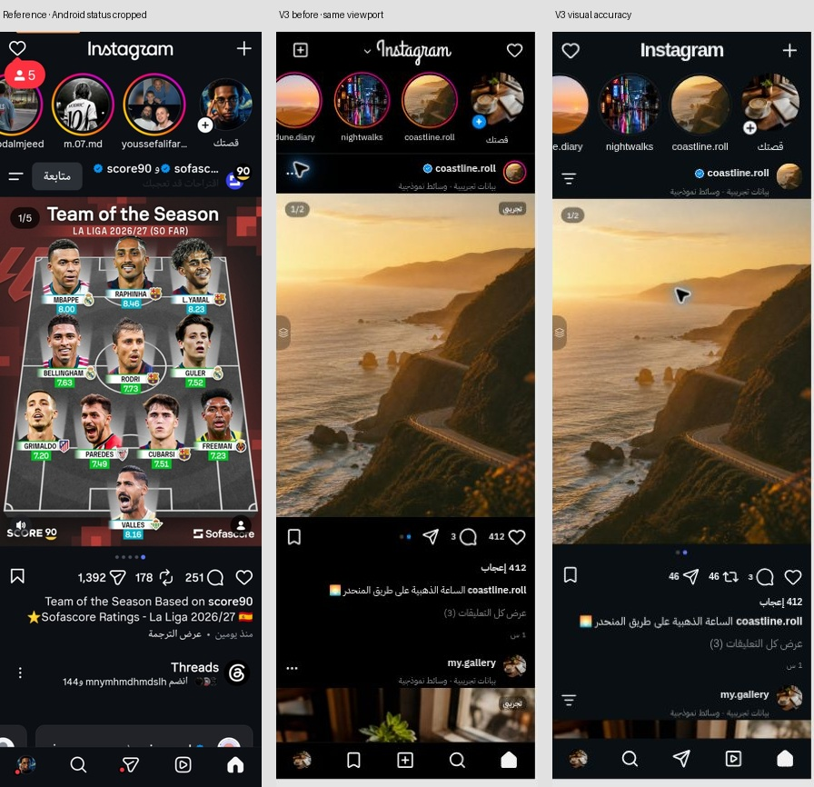
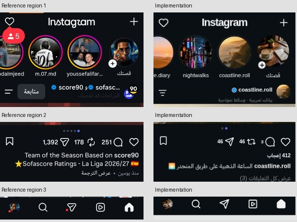

الفروق التي أصلحت:

1. كان زر + على يسار الرأس والقلب على اليمين في RTL. أصبح القلب يسارًا و+ يمينًا وشعار Instagram وسطيًا، دون سهم إضافي بجواره. استُخدم Arial بوصفه خط نظام متاحًا، لا ملف خط مستوردًا؛ لم يُستورد خط/شعار أصلي مملوك.
2. Stories بعرض 88px، وصورة المستخدم 80px وإضافة صغيرة بلون الواجهة. الأسماء أسفل الدوائر. الإطار المتدرج موجود للقصص غير المشاهدة، والرمادي للمشاهدة. **صورة بعد مأخوذة بعد اختبار Stories، لذلك بعض الإطارات فيها رمادي فعلًا.**
3. رأس المنشور 56px وصورة الحساب 36px؛ مؤشر عدد صور الألبوم في أعلى يسار الوسائط في RTL. النقاط أصبحت صفًا مركزيًا مستقلاً أسفل الصورة، بدل تداخلها مع الأفعال.
4. الصورة العمودية بنسبة 3:4 حين تسمح أبعادها، بدل فرض 4:5 على كل صورة. أول صورة 360×480، قريبة من نسبة صورة المرجع 513×684. المربع يبقى مربعًا، والحد الأقصى للطول 4/3 من العرض. الصور الأطول متاحة كاملة من خيارات الصورة.
5. الأفعال: لايك، تعليقات، إعادة نشر محلية، مشاركة/نسخ الوصف؛ الحفظ مستقل في الطرف الآخر. بقيت قائمة أصحاب الإعجاب والعدادات المحلية. خلفية داكنة قريبة من `#0c1014` بدل الأسود التام.
6. ترتيب التنقل العربي: الرئيسية، المحفوظة بأيقونة مربعة، الرسائل بحالة «غير متاحة»، البحث، الملف. **المربع يفتح الصور المحفوظة ولا يعرض Reels.** إضافة الصور باقية في الرأس؛ لا خدمة مراسلة مزيفة.
7. قلب الضغط المزدوج عند موضع اللمس، 670ms بدل 800ms، بنفسجي/وردي بدل البدء بلون ذهبي غير مدعوم بالمشاهدة. السحب لا يحتسب لايك. أضيف تنقل بالألبوم من لوحة المفاتيح يتبع RTL.

## TikTok — الفيديوهات

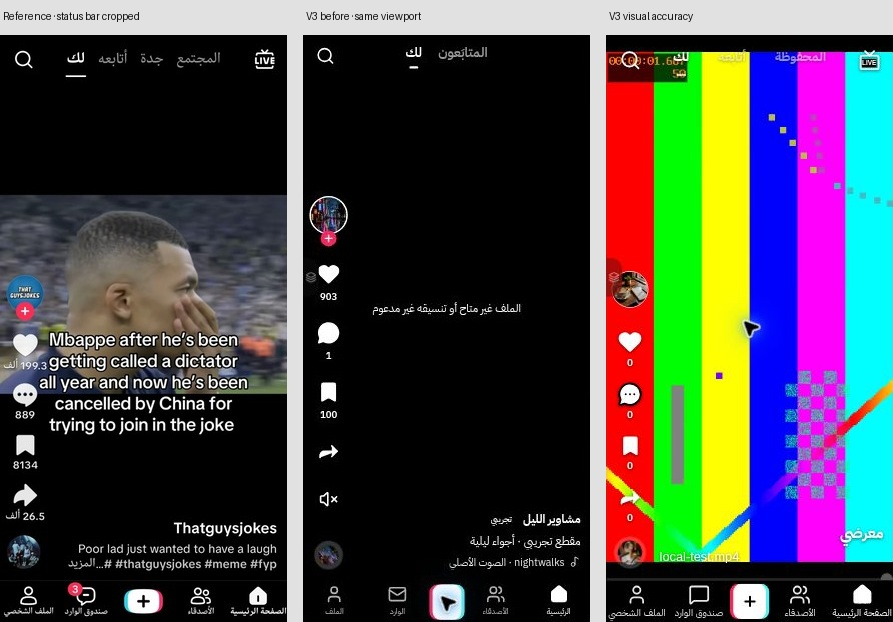
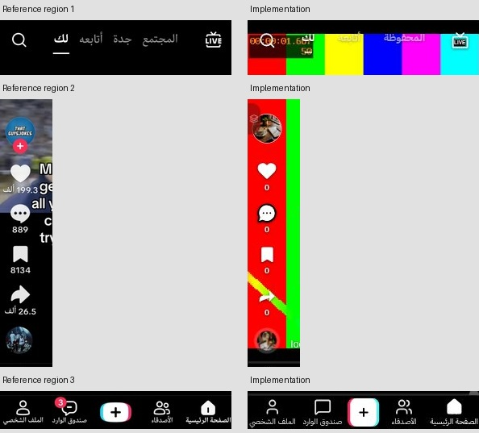
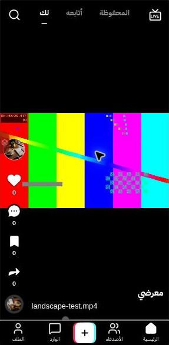

الفروق التي أصلحت:

1. البحث يسارًا وLIVE يمينًا، وبينهما تبويبات محلية: المحفوظة / أتابعه / لك مع مؤشر واضح. **لم ننسخ «جدة» أو «المجتمع»** لأن الموقع لا يملك محتوى جغرافيًا أو مجتمعًا متصلاً. LIVE يعطي رسالة عدم إتاحة صريحة. البحث أصبح بحثًا فعليًا في مقاطع الجهاز/العينات، مع إبقاء الأصدقاء مرشحًا للحسابات المتابعة.
2. شريط سفلي 52px، أيقونات 27px وزر إضافة 49×31px. التسميات الكاملة: الصفحة الرئيسية / الأصدقاء / + / صندوق الوارد / الملف الشخصي. لا overflow في عرض 359px؛ الزر المركزي يستورد فيديو فعليًا، والوارد يشرح عدم توفره.
3. عمود التفاعل على اليسار في RTL؛ صورة الحساب 46px، القلب 34px، الحفظ 31px، عدادات 12.5px، ونهايته على بعد 14px من أسفل مساحة الفيديو. بقيت مناطق لمس ≥44px. أيقونة التعليق تحوي النقاط الثلاث. نقل كتم الصوت إلى زر القرص بدل إضافة سطر مستقل غير موجود في المرجع.
4. اسم الحساب والوصف فوق التنقل، مع `dir=auto` للنص المختلط. الفيديوهات فقط في هذا القسم.
5. `videoFit` يقارن أبعاد الفيديو الحقيقية بعد metadata بأبعاد الحاوية بعد ResizeObserver: `cover` فقط إذا كان فرق النسب ≤6%، وإلا `contain`. لا قص للفيديو الأفقي/العمودي الشديد، ولا فرض contain على المقاطع المطابقة تقريبًا. اختُبر 640×360 أفقيًا و360×640 عموديًا؛ كلاهما يعمل ويحتفظ بإطاره في المقاس المختبر.
6. عند إدخال مقطع جديد، لا يحتفظ المتصفح بمرساة المقطع القديم؛ يظهر المستورد في البداية. أضيف تركيز منطقة التغذية لتعمل PageDown/PageUp دون تحويل السحب إلى نقر.
7. لايك أحمر، وحفظ أصفر مع ارتداد/ضغط رأسي وحلقة متأخرة أقرب لتسلسل المصدر، وإلغاء أقصر. انظر أدلة الحركة أدناه.

## X — الملاحظات

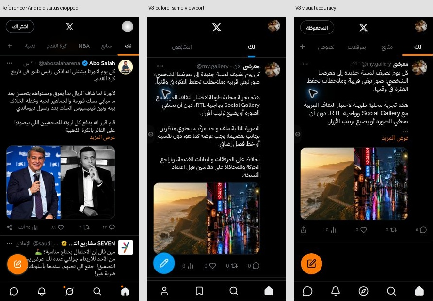
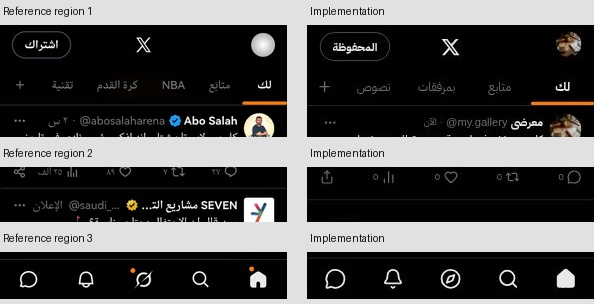

الفروق التي أصلحت:

1. رأس 54px: صورة الحساب يمينًا، X وسطًا، وزر المحفوظة يسارًا بدلاً من اشتراك غير موجود في المنتج. تبويبات 46px بمؤشر يملأ عرض التبويب. الفلاتر **لك / متابع / بمرفقات / نصوص** محلية فعلية؛ لا NBA/إعلانات/خدمات اجتماعية مزعومة.
2. ترتيب الاسم والمعرّف والتوقيت مستقل، مع `bdi dir=ltr` للمعرف. صُغّر هامش Avatar إلى المحتوى، وضُبط حجم النص 16px وارتفاع السطر 21px. النص الطويل يطوى إلى 8 أسطر مع «عرض المزيد / أقل»، دون اقتطاع القيمة المحفوظة أو نص عرض الموضوع الكامل.
3. خمسة مواضع للأفعال الصغيرة 18px أسفل البطاقة. الحفظ في قائمة خيارات الملاحظة وفي عرض الموضوع، للوصول إليه دون زيادة عمود سادس على صورة المرجع.
4. زر الإنشاء أصبح مثبتًا فوق شريط التنقل، لا عنصرًا sticky يتأثر بارتفاع المنشور. خمسة عناصر في الأسفل: الرئيسية، البحث، المحفوظة، تفاعلاتي المحلية، الرسائل غير المتاحة. الملف الشخصي باقٍ من صورة الرأس. رمز Compass بديل محلي للمحفوظات وليس Grok.
5. بقي مرفق واحد لصورة أو فيديو، معاينة، إزالة، استبدال، وتثبيت آمن. **الصورة المركبة لم تُقسَّم:** اختُبر ملف 800×540 يحوي منظرين، فظهر عنصر `` واحد بنفس نسبة 1.481، بلا grid أو خط فاصل. صورة المرجع التي فيها شخصان تعامل على أنها ملف واحد كذلك.
6. صححنا أيضًا تحذير `src=""` العابر في معاينة المرفق؛ لا يُرسل src فارغ قبل تجهيز object URL.

### اختيار أي لون بدلاً من البرتقالي

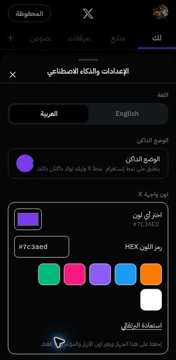
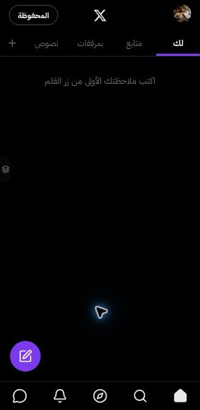

من **تبديل الواجهة ← الإعدادات والذكاء الاصطناعي ← لون واجهة X**:

- منتقي النظام لأي لون sRGB، وحقل HEX كامل مثل `#7c3aed`، وستة ألوان جاهزة وزر استعادة البرتقالي.
- الرمز غير المكتمل لا يستبدل الاختيار الصحيح السابق؛ تظهر إرشادات قصيرة. تحفظ القيمة محليًا في `social-gallery-v1` وتستعاد بعد reload.
- يتغير زر الإنشاء والنشر والمؤشر والتوكينات الأساسية في X فقط. ألوان اللايك/الحفظ المميزة وInstagram وTikTok مستقلة.
- يختار النص الأسود أو الأبيض آليًا لأعلى تباين على الزر. للزر إطار خفيف حتى عند اختيار الأسود. البيانات القديمة التي لا تحتوي اللون تظل تعمل مع البرتقالي الافتراضي.
- التحقق الفعلي: البنفسجي `#7c3aed` ظهر `rgb(124,58,237)` مع نص أبيض، وبقي كذلك بعد إعادة التحميل. اختُبر أيضًا حقل HEX آليًا بالقيم الصحيحة والناقصة والاستعادة دون تغيير الملاحظات.

## الحركة: ما شوهد وما اختير

مصادر الفيديو وتحليل المدة/الإطارات الكامل في [تدقيق V3 السابق](V3_UI_MOTION_AUDIT.md). استخراج النافذة السابقة كل 66.7ms هو حد أخذ العينات، وليس دقة المصدر الفعلية. اختلاف تكرار الإطارات/ضغط التسجيل يرفع عدم اليقين. لم ندّعِ قياس spring الأصلي أو input latency.

| التفاعل | نافذة المصدر المرئية | القرار الحالي وحدوده |
| --- | --- | --- |
| TT Like | أحمر قرابة 3.000s، قمة 3.067s، استقرار قرابة 3.333s | 300ms، scale .8 → 1.18 → .96 → 1، إلغاء 160ms؛ منحنى تقريبي |
| TT Save | أصفر 8.133s، انضغاط رأسي قرابة 8.333s، حلقة 8.467–8.667s، استقرار نحو 8.8s | ارتداد 700ms مع scaleY=.5، حلقة 300ms بتأخير 330ms، أصفر أفتح؛ هامش المصدر ≥67ms |
| IG double tap | أول قلب صغير 8.400s، قمة 8.533s، نهاية نحو 9.067s | 670ms؛ scale .25 → 1.1 → 1 → .9، opacity 0 → 1 → 0، بنفسجي/وردي؛ لم ننسخ اللمعان أو التدرج المملوك حرفيًا |
| IG Like / unlike | تفعيل وإلغاء واضحان، أحجام دقيقة صغيرة في الفيديو | 300ms / 160ms؛ الاختلاف هندسي معلن |
| X | دقة الأيقونات لا تكفي لاشتقاق spring | 220ms / 140ms، أهدأ من TikTok؛ اختيار تصميمي |
| Switcher | المصدر 12fps تقريبًا؛ مرئي كاملًا 3.333s ويختفي 3.400s | دخول 240ms، خروج 180ms، إبقاء mount أثناء الخروج؛ لا نعتبر تأخر المصدر قياسًا صحيحًا لزمن التصميم |

إطارات المصدر الأصلية:

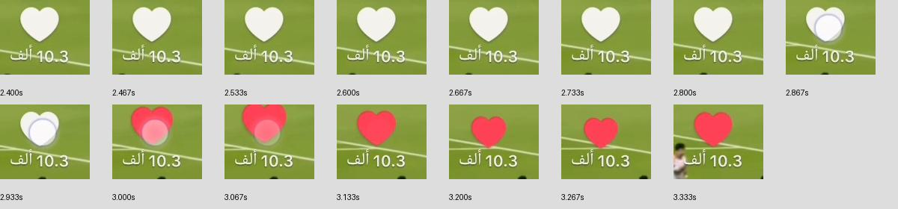
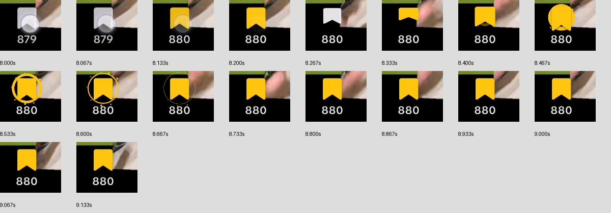
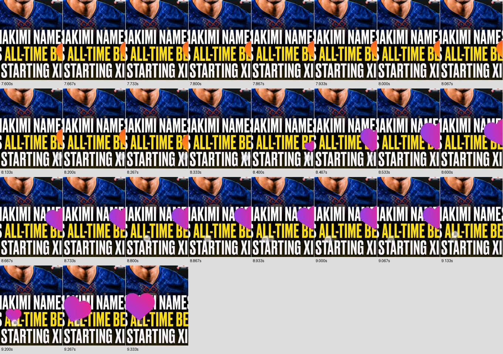
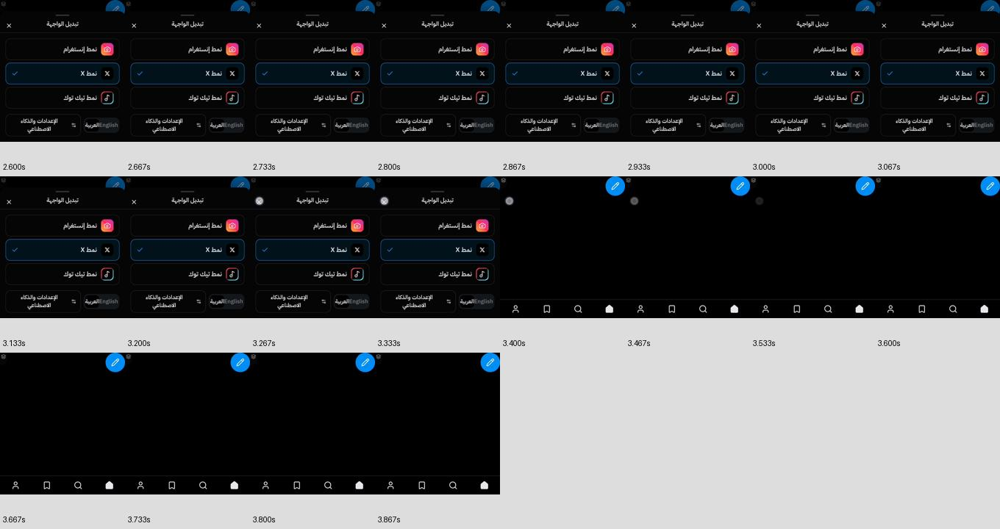

**لا تتوفر أداة تسجيل شاشة في المتصفح هنا.** بدلاً من فيديو مزعوم، هذه عينات مرسومة بالمتصفح من CSS الفعلي عند إزاحات معلنة، مع إيقاف الحركة و`animation-delay` سالب. هي فحص keyframes، وليست قياسًا للأداء أو تسجيلًا زمنيًا للتطبيق. صف القائمة يعرض نمط CSS على لوحة اختبار مصغرة؛ دورة mount/unmount اختُبرت على المكوّن الحقيقي منفصلًا.

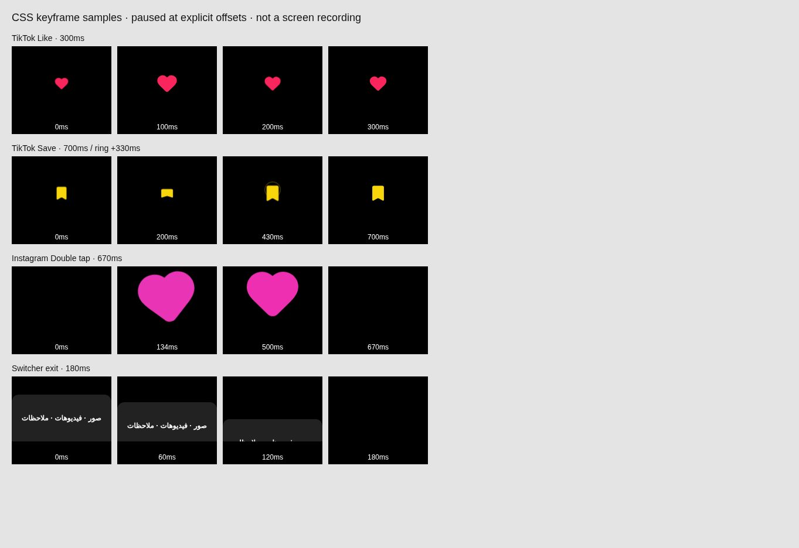
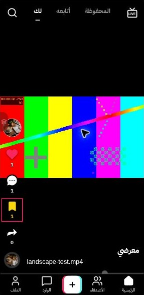

## البيانات والاختبارات

لا حذف ولا إعادة ضبط لبيانات المستخدم ولا ترحيل مدمر. مفتاح localStorage وقاعدة IndexedDB ومخزنا `media` و`noteMedia` وترقية V3 محفوظة. لم تُضَف خدمة Lovable أو رفع سحابي أو تبعية npm جديدة.

| الفحص | النتيجة |
| --- | --- |
| `npm run typecheck` | ناجح |
| `npm run lint` | 0 أخطاء، 7 تحذيرات Fast Refresh سابقة |
| `npm run test` | 31 اختبارًا في 5 ملفات؛ جميعها ناجحة |
| `npm run build` | ناجح، static SPA؛ routes نحو 53KB gzip |
| ملاحظات/مرفقات بعد reload | صورة وملاحظة طويلة وفيديو بقيت؛ استبدال الصورة 800×540 بصورة 864×1152 نجح؛ النص بقي |
| فيديو ملاحظة X | readyState=4، 360×640، controls=true، muted=true، autoplay=false؛ تشغيل بلوحة المفاتيح |
| فيديو TikTok أفقي/عمودي | metadata صحيحة، contain في هاتين الحالتين، paused=false وcurrentTime يتقدم؛ حالة cover المطابقة تقريبًا مغطاة باختبار مستقل |
| Like / Save / unlike | حالات aria-pressed والتلوين الأحمر/الأصفر فُحصت؛ مدد CSS الحقيقية قُرئت من DOM |
| التعليقات | نشر تعليق TT وفتحه/إغلاقه، تعليقات الصور، Escape؛ محفوظة محليًا |
| ألبوم IG | انتقال RTL إلى 2/2 بـArrowLeft ثم العودة، صورة واحدة بلا مؤشر وهمي، لايك بالضغط المزدوج؛ إلغاء اللايك والسحب آليًا |
| Stories / بحث / فلاتر | فتح Stories وإغلاقها تلقائيًا، بحث فيديوهات محلي وحالات لا نتائج، فلترة ملاحظات النص/المرفق آليًا |
| Switcher | 5 دورات من كل منصة (15 مجموعًا): صفر طبقات باقية والتركيز عاد؛ Browser Back أغلق القائمة وبقي العنوان نفسه |
| مقاسات الهاتف | 359×734 و393×873؛ IG مقارنة 360×1039 لتناسب صورته الطويلة؛ root وnav دون overflow أفقي |
| سعة التخزين/هجرة v1 | اختبارات V3 السابقة باقية: فشل metadata يحتفظ بالقديم، الملف الجديد ينظف بأمان، ترقية v1 تحفظ الوسائط |
| reduced motion | قاعدة CSS السابقة باقية وتغطي الحركة الجديدة بـ!important؛ حلقة الحفظ مخفية. مسار إغلاق فوري مغطى بمحاكاة matchMedia في الاختبارات؛ لم نغير إعداد النظام الحقيقي |
| Console | بعد تصحيح src الفارغ وإعادة التحميل لم يظهر خطأ تطبيق جديد؛ رسائل إضافة Chrome الخارجية منفصلة، وبعض روابط العينات غير متاحة |

## فروقات متبقية وقبول المراجعة

- Arial / IBM Plex بدائل متاحة، وليست خطوط المنصات المملوكة. شكل كلمة Instagram وstroke بعض أيقونات Lucide/سهم المشاركة وشكل إطار + قريبة وتبقى فروقات دقيقة. XLogo الموجود أصلًا محفوظ.
- غياب النقاط الحمراء/أعداد الإشعارات/الإعلانات/Threads/الاشتراكات مقصود لعدم وجود تلك الخدمات. الأيقونات المماثلة ترتبط بوظائف المعرض المحلية أو توضح عدم الإتاحة.
- كثافة النص والعدادات تتغير بالمحتوى. النص التجريبي أطول من منشور X المرجعي، لذلك موقع الصورة بعد الطي ليس تطابقًا بكسليًا رغم ثبات العرض والنسبة. لا نغير بيانات المستخدم كي نُحسّن لقطة مصطنعة.
- الفيديو الأفقي الفعلي في المرجع ليس 16:9 بالضرورة، وقد يتضمن letterboxing داخل الملف؛ لا يمكن نسخ ارتفاع شريطه الأسود لجميع الملفات دون قص/تشويه. سياسة الأبعاد معلنة أعلاه.
- لم يُختبر Android فعلي أو TalkBack أو سحب إصبع على جهاز حقيقي، ولا FPS/GPU/battery أو zoom بنظام الهاتف. ليست هذه شهادة مطابقة 100% أو امتثال وصول شامل.
- لا فيديو مقارنة حي متزامن متاح؛ إطارات المصدر وعينات CSS موثقة بوضوح.

## المعاينة وتسليم الفرع

- المعاينة العاملة مفتوحة في المتصفح السحابي. كل عناوين نشر Sites المتاحة هنا إنتاجية؛ لذلك لم ننشر فوق الموقع الحالي ولم ننشئ مشروعًا جديدًا.
- أُنتج **ملف HTML مستقل** من المكونات نفسها، بصور مضمّنة وتاريخ توجيه داخلي، عبر `node scripts/build-portable-preview.mjs <output.html>`. يمكن تنزيله وفتحه في متصفح يدعم تشغيل ملفات HTML المحلية. لا يحتوي ملفات المستخدم الاختبارية أو التسجيلات، وروابط عينات الفيديو الخارجية تظل خارجية. استيراد ملف محلي متاح.
- فُتح ملف المعاينة نفسه عبر HTTP في Chrome، وعملت الصور والتنقل إلى X. **لم نتحقق من file:// على Android**؛ دعم فتح الملف وحفظ IndexedDB يتبع المتصفح/مدير الملفات، وبيانات نسخة الملف مستقلة عن الموقع المنشور. هذا ملف تجربة وليس رابط استضافة عامًّا.
- طلب الدمج نفسه #3 يبقى مفتوحًا وغير مدموج. موافقة المستخدم البصرية شرط الدمج والنشر.
